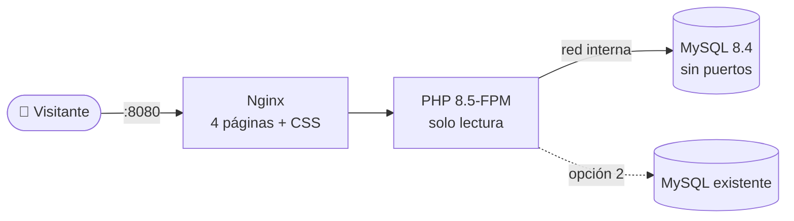

<div align="center">

# 🎭 Teatro · Venta de entradas en línea

**Prueba técnica PHP + MySQL**: el usuario ve las obras disponibles, elige una,
escribe su identificador y recibe su número de entrada.


[**Instalación**](#instalacion) ·
[**Cómo probarlo**](#probar) ·
[**Pruebas automáticas**](#pruebas) ·
[**Cómo funciona**](#funcionamiento) ·
[LEAME](LEAME.md) ·
[Guía PDF](GUIA-INSTALACION.pdf)

</div>

---

## ✨ Qué hace

| | |
|---|---|
| 📋 **Cartelera** | Lista las obras con entradas disponibles y fecha futura (`index.php`). |
| 🎟️ **Compra** | Pide el identificador, registra la venta y muestra el **número de entrada autoincremental**. |
| 🔒 **Sin sobreventa** | La venta y el descuento de `disponibles` ocurren en **una sola transacción**, también con compras simultáneas. |
| 🔎 **Consultar mi entrada** | Recupera la entrada desde cualquier navegador con su número y el identificador. |
| 🛡️ **Listo para producción** | Instalador con menú, contenedores endurecidos, sin claves por defecto y sin errores técnicos en pantalla. |

Hecho en **PHP sin frameworks**, **MySQL** y **HTML/CSS**, sin JavaScript.

---

<a id="instalacion"></a>

## 🚀 Instalación en 1 minuto

> **Requisitos:** Linux con Docker Engine 24+ y Docker Compose v2. Si falta
> Docker, el instalador ofrece instalarlo.

```bash
git clone https://github.com/devsfernandol/TEATROV1.git
cd TEATROV1
sudo ./instalar.sh
```

El instalador muestra un menú:

```
Teatro · Instalación con Docker

  1) Instalar con un MySQL nuevo, en Docker (recomendado: no necesita nada más)
  2) Instalar usando un MySQL que ya existe (pide sus credenciales)
  3) Ver el estado
  4) Desinstalar
  0) Salir
Opción [1]:
```

<table>
<tr><th width="50%">1️⃣ MySQL nuevo en Docker</th><th>2️⃣ MySQL que ya existe</th></tr>
<tr valign="top"><td>

- Pregunta el **puerto** y la **zona horaria**. Basta con pulsar Enter.
- Levanta **Nginx + PHP 8.5 + MySQL 8.4**.
- Importa la base `TEATRO` sola.
- Crea el usuario `teatro_app` con una **clave aleatoria**.

</td><td>

- **En este servidor:** se conecta por el socket, sin abrir MySQL a la red.
- **En otro servidor:** pide la IP y el puerto.
- Pide un usuario administrador, por ejemplo `root`. **Esa clave no se guarda.**
- Importa la base `TEATRO` o conserva la que ya existe.
- Crea `teatro_app` con **permisos mínimos**.

</td></tr>
</table>

Al terminar, comprueba que la aplicación responde y muestra la dirección:

```
✓ Teatro está funcionando (MySQL en Docker).

   Dirección:      http://203.0.113.10:8080/
   Configuración:  .env (permisos 600, contiene las claves)
   Estado y logs:  docker compose ps · docker compose logs php
   Este menú:      ./instalar.sh
```

> 💡 **Volver a ejecutarlo** actualiza la instalación y **conserva los datos**,
> salvo que elija empezar de cero. Para HTTPS, responda `127.0.0.1:8080` como
> puerto y ponga un proxy (Caddy, Nginx) delante. Está detallado en el
> [LEAME](LEAME.md#https-opcional).

---

<a id="probar"></a>

## 🧪 Cómo probarlo

### Datos de prueba

| Cód. | Obra | Disponibles | ¿Aparece? |
|:-:|---|:-:|---|
| 1 | La casa de Bernarda Alba | 120 / 120 | ✅ |
| 2 | Bodas de sangre | 78 / 80 | ✅ |
| 3 | La vida es sueño | **2 / 5** | ✅ hasta que se vendan las 2 |
| 4 | Don Juan Tenorio | 200 / 200 | ✅ |
| 5 | El sí de las niñas | 60 / 60 | ✅ |
| 6 | Luces de bohemia | **0 / 3** | ❌ agotada |
| 7 | Fuenteovejuna | 48 / 50 | ❌ su fecha ya pasó |

Las fechas se calculan al importar la base, así que siempre hay obras futuras.
Hay 10 ventas previas: **la primera compra genera la entrada 11**.

### Recorrido en 2 minutos

- [ ] Abrir la dirección: aparecen **5 obras**, sin la agotada ni la pasada.
- [ ] *La vida es sueño* → **Comprar entrada** → `V-12345678`: **«¡Compra realizada con éxito!», entrada 11**.
- [ ] Comprar la última entrada de esa obra: entrada 12, y la obra **desaparece de la cartelera**.
- [ ] En una ventana privada, abrir `/confirmacion.php?venta=11`: **«Entrada no encontrada»**.
- [ ] Ahí mismo, **Consultar mi entrada** con `11` + `V-12345678`: se muestra la entrada.
- [ ] Revisar la base:

```bash
sudo docker compose exec db sh -c 'mysql -uteatro_app -p"$TEATRO_DB_PASSWORD" TEATRO'
```
```sql
SELECT * FROM VENTAS ORDER BY numero_venta DESC LIMIT 1;  -- venta 11, obra 3, V-12345678
SELECT disponibles FROM OBRA WHERE cod_obra = 3;          -- bajó de 2 a 1
```

### Errores controlados

| Prueba | Resultado esperado |
|---|---|
| Identificador vacío, `ab`, `<script>` o `1' OR '1'='1` | Mensaje claro, sin venta y sin ejecutar nada |
| F5 en la confirmación o doble clic en «Comprar» | **Una sola** venta |
| 5.ª entrada de la misma obra con el mismo identificador | «Máximo de 4 entradas permitidas para esta obra» |
| Más de 20 compras por hora desde la misma IP | «Demasiadas compras» |
| `comprar.php?obra=6`, `=7`, `=999` o `=abc` | «Obra no disponible» |
| `/database/teatro.sql`, `/.env`, `/includes/config.php` | **404** |
| `sudo docker compose stop db` y recargar | «Servicio no disponible», sin detalles técnicos |

---

<a id="pruebas"></a>

## ✅ Pruebas automáticas

**281 comprobaciones**, todas superadas con PHP 8.1 y PHP 8.5:

| Suite | Comprobaciones | Qué cubre |
|---|:-:|---|
| [`dev/pruebas.sh`](dev/pruebas.sh) | **131** | Cartelera, compra, validación, CSRF, XSS, inyección SQL, cabeceras y cookie, doble envío, consultar entrada, **concurrencia**, bloqueos de MySQL e integridad de datos |
| [`dev/prueba-instalacion.sh`](dev/prueba-instalacion.sh) | **96** | Contenido del ZIP, instalación en una carpeta limpia, importar la base dos veces, esquema según el enunciado, límites por IP, conexión por socket, MySQL caído o con la clave incorrecta |
| [`dev/prueba-docker.sh`](dev/prueba-docker.sh) | **54** | El instalador en un **servidor real con Docker**: los 3 modos (Docker, socket y red), clave incorrecta, actualizar, empezar de cero, archivos internos con 404, permisos de `.env` y desinstalar |

### Escenarios de concurrencia probados

| Escenario | Resultado |
|---|---|
| 🏃 20 personas compran **a la vez** las 2 últimas entradas | Exactamente **2 ventas**; nunca se supera el aforo |
| 🖱️ El mismo formulario enviado 10 veces a la vez | **1 venta** |
| 👥 El mismo identificador desde 5 navegadores a la vez | Exactamente **4 ventas** (el máximo por persona) |
| 🔒 MySQL bloqueado por otra transacción | La compra se reintenta sola, **sin duplicarse** |
| 💥 MySQL caído | Página amigable; el detalle va al log, **sin contraseñas** |

<details>
<summary><b>Ejecutar las pruebas</b> (Linux o WSL)</summary>

<br>

El entorno de `dev/` usa su propio PHP 8.5.12 y su propio MySQL en `.dev/`,
sin `sudo` y sin tocar los del sistema.

```bash
sudo apt install build-essential libssl-dev zlib1g-dev mysql-server curl python3   # una sola vez

dev/iniciar.sh                         # app en http://localhost:8000 (otra terminal)
dev/pruebas.sh                         # ✓ 131 pruebas correctas
dev/prueba-instalacion.sh              # ✓ 96 comprobaciones correctas
PHP_BIN=/usr/bin/php dev/prueba-instalacion.sh   # lo mismo con otro PHP (8.1)
dev/prueba-docker.sh usuario@servidor  # ✓ 54 comprobaciones, en un Linux con Docker
```

| Otros scripts | |
|---|---|
| `dev/reiniciar-bd.sh` | Restaura la base desde `database/teatro.sql` |
| `dev/empaquetar.sh` | Genera el ZIP de entrega en `dist/` |
| `dev/generar-guia.sh` | Regenera `GUIA-INSTALACION.pdf` |

</details>

---

<a id="funcionamiento"></a>

## ⚙️ Cómo funciona



### Una venta, sin vender de más

```sql
START TRANSACTION;
UPDATE OBRA SET disponibles = disponibles - 1
 WHERE cod_obra = ? AND disponibles > 0 AND fecha_obra > NOW();     -- 0 filas = agotada
SELECT COUNT(*) FROM VENTAS WHERE cod_obra = ? AND comprador = ? FOR UPDATE;  -- máximo 4
INSERT INTO VENTAS (cod_obra, comprador, fecha_compra) VALUES (?, ?, NOW());
COMMIT;                                                              -- LAST_INSERT_ID() = n.º de entrada
```

El `UPDATE` bloquea la fila de la obra hasta el `COMMIT`, así que las compras
simultáneas se atienden de a una.

### Seguridad

| Riesgo | Protección |
|---|---|
| Inyección SQL / XSS | Sentencias preparadas · escape de toda la salida · CSP `script-src 'none'` |
| Compras duplicadas / CSRF | Token de un solo uso · POST/Redirect/GET · cookie `SameSite=Lax` |
| Bots | Límite por persona y obra, por IP y por segundo (Nginx) |
| Entradas ajenas | Solo las de la sesión, o con número **y** identificador |
| Archivos y claves | Nginx solo publica 4 páginas · `.env` con permisos 600 · **sin claves por defecto** |
| Base de datos | Usuario con permisos mínimos · red interna sin puertos · root con clave aleatoria |
| Contenedores | Sistema de archivos de solo lectura · `no-new-privileges` |

---

## 📁 Estructura

```
├── index.php · comprar.php · confirmacion.php · consultar.php   Páginas
├── includes/            Conexión, consultas, sesión, límites y plantillas
├── assets/css/          Estilos
├── database/teatro.sql  Esquema TEATRO + datos de prueba (respaldo)
├── instalar.sh          Instalador con menú
├── docker-compose.yml   Nginx + PHP · docker/mysql-*.yml agrega el modo de MySQL
├── docker/              Configuración de producción de Nginx, PHP y MySQL
├── LEAME.md · GUIA-INSTALACION.pdf
├── dev/                 Entorno de desarrollo y pruebas (no va en la entrega)
└── deploy/              Despliegue de la demo del autor (no va en la entrega)
```

<div align="center">

Hecho por **Fernando** · [devsfernandol](https://github.com/devsfernandol)

</div>
